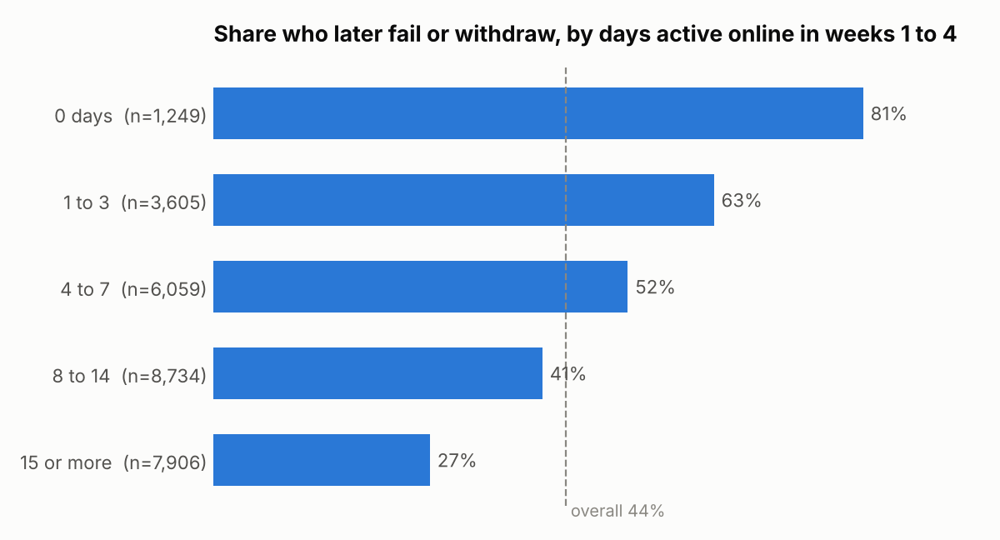
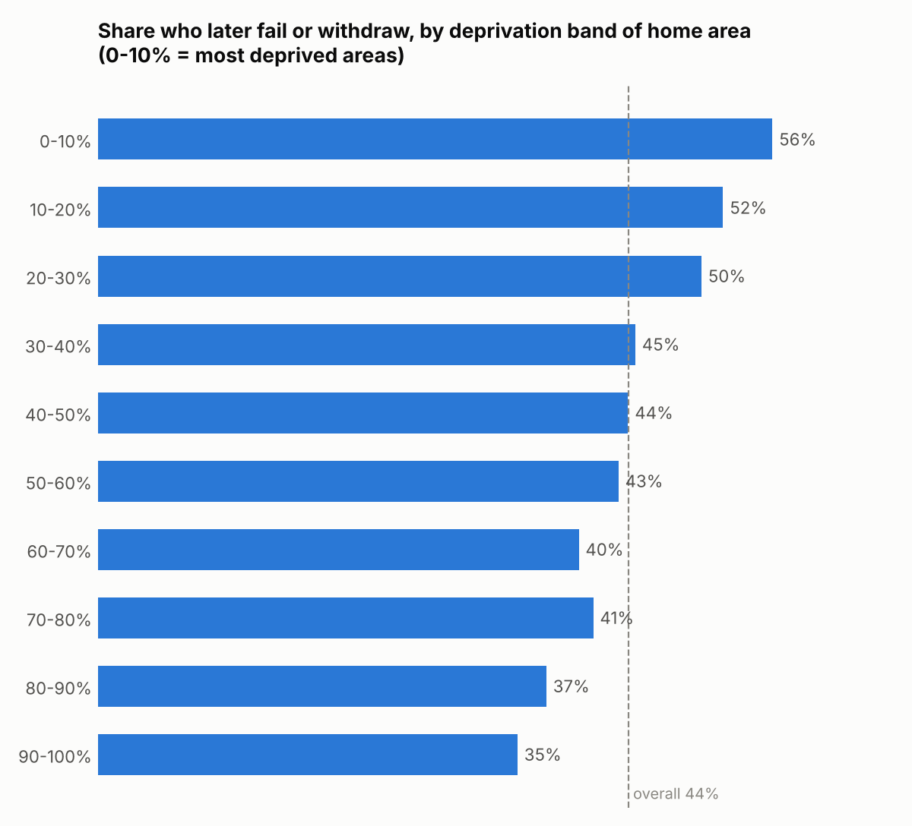
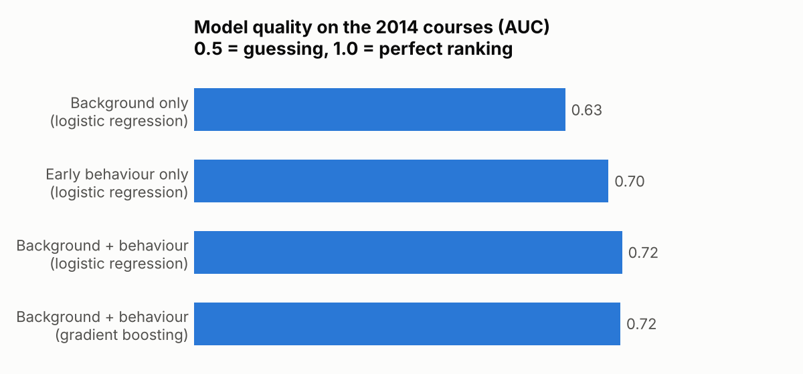
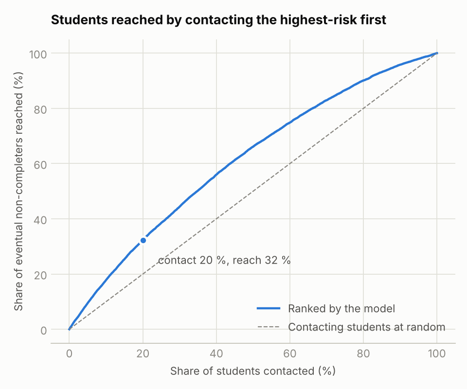

# Early Warning for Student Drop-out: Learning Analytics on Open University Data

Before I moved into data analysis I taught English for several years. Every teacher knows the student who goes quiet in the first weeks and is gone by mid-term. This project asks whether that can be seen in the data: **four weeks into a course, can we tell which students are at risk of not finishing, early enough to do something about it?**

**Main results**

- Of 32,593 course enrolments, **53 % ended in a fail or a withdrawal**. 15 % of students had already left by the end of week 4.
- Early online activity is a strong signal. Among students still enrolled after four weeks, **81 % of those who never logged in went on to fail or withdraw**, against 27 % of those active on 15 days or more.
- What students *do* in the first four weeks predicts the outcome better than who they *are*: a model using only early behaviour scores an AUC of 0.70, a model using only background data (education, age, deprivation, gender, disability) scores 0.63.
- If tutors contacted the 20 % of students the behaviour model ranks as highest risk, **71 % of those contacted would be students who later do not complete** (the average is 44 %).

## Data

[Open University Learning Analytics Dataset (OULAD)](https://analyse.kmi.open.ac.uk/open_dataset): anonymised records from a UK distance-learning university, 2013 and 2014.

- 32,593 enrolments by 28,785 students in 7 courses and 22 course runs
- Seven linked tables: student background, registrations, courses, assessments, and a click log of 10.6 million rows from the online learning platform
- Licence: CC BY 4.0. Citation: Kuzilek J., Hlosta M., Zdrahal Z. (2017), *Open University Learning Analytics dataset*, Scientific Data 4:170171.

The raw files (about 460 MB) are not in this repository. `student_features.csv` is the cleaned table built from them, one row per enrolment, so the analysis can be re-run without downloading anything.

## Method

### 1. Cleaning and preparation (`01_prepare_data.py`)

| Issue in the raw data | What I did |
|-----------------------|------------|
| Missing values written as `?` | read as missing |
| One deprivation band written as `10-20` and the others as `20-30%` etc. | made consistent |
| Deprivation band missing for 1,111 students | kept as its own category, `unknown` |
| Registration date missing for 45 students | filled with the median |
| Very small categories (e.g. 216 students aged 55+) | merged with the neighbouring category |
| Students with no rows in the click log | counted as 0 clicks |
| A student can take several courses | analysed per enrolment, checked that each is unique |

The click log is read in chunks, and only clicks up to day 27 are kept (2.8 million rows). From these I built: total clicks, number of active days, number of active weeks, the last day the student was active, clicks before the course started, and the student's click rank among classmates on the same course run (because some courses simply require more clicking than others).

### 2. Analysis (`02_analysis.py`)

- **Who is included:** the 27,553 students still enrolled at the end of week 4. The 5,040 who left earlier are counted but set aside, since an early warning comes too late for them.
- **Outcome:** did not complete = final result is Fail or Withdrawn.
- **Validation:** models are trained on the 2013 course runs (11,818 students) and tested on the 2014 runs (15,735 students). That mirrors real use: learn from last year, apply to this year.
- **Statistics:** with this many students almost any difference is statistically significant, so each test is reported with an effect size.

## Findings

### Early activity and outcome



Completers were active on a median of 12 days in the first four weeks, non-completers on 7 (Mann-Whitney U, p < 0.001). If you pick one completer and one non-completer at random, the completer is the more active one 67 % of the time.

### Background and outcome



Students from the most deprived areas do not complete in 56 % of cases, students from the least deprived in 35 %. The relationship is statistically clear (chi-square, p < 0.001) but weak in size (Cramér's V = 0.13): deprivation shifts the odds, it does not decide the outcome. Prior education shows a similar gap: 53 % non-completion for students without A levels, 36 % for those with a higher-education qualification.

### How well can non-completion be predicted after four weeks?



Behaviour alone beats background alone. Adding background to behaviour helps a little (0.70 to 0.72). A more complex model (gradient boosting) does no better than logistic regression.

An AUC of 0.70 is useful but far from certain. It is good enough to decide whom to contact first, and not good enough to label any individual student.

### What would a tutor team get out of it?

For the outreach list I use the behaviour-only model. It gives up very little accuracy, and it flags students for what they did, not for their age, gender, disability or postcode.



| Students contacted (highest risk first) | Share of them who later do not complete | Share of all non-completers reached |
|---|---|---|
| Top 10 % (1,573) | 78 % | 18 % |
| Top 20 % (3,147) | 71 % | 32 % |
| Top 30 % (4,720) | 65 % | 44 % |
| Top 50 % (7,867) | 58 % | 66 % |

For comparison, a rule that needs no model at all, "contact everyone who was active on 3 days or fewer", flags 18 % of students, of whom 67 % do not complete. The model is better than the rule, but only moderately. For a school without a data team, the simple rule would already be a reasonable start.

## Limitations

- **A signal, not a cause.** Low activity goes together with dropping out; this does not show that getting a student to click more would change the outcome. Whether contacting flagged students helps would need a trial.
- **One university, ten years ago.** These are adult distance learners in the UK in 2013 and 2014. The patterns may not carry over to schools or to classroom teaching.
- **Clicks are a rough measure of engagement.** A student can study from printed material and barely log in.
- **Fail and withdrawal are combined.** They probably have different causes and would deserve separate models.
- **Early assessment results are not used**, because the first deadline falls between day 12 and day 61 depending on the course. Including them per course is the obvious next step.
- **Four weeks is a choice.** A warning after two weeks would be more useful and less accurate; I have not yet measured that trade-off.

## Files

| File | Content |
|------|---------|
| `01_prepare_data.py` | cleans the raw tables and builds the features |
| `02_analysis.py` | descriptive analysis, tests, models, charts |
| `student_features.csv` | cleaned data, one row per enrolment |
| `outcomes.csv`, `non_completion_by_*.csv` | descriptive results |
| `statistical_tests.csv` | test results with effect sizes |
| `model_comparison.csv`, `outreach_scenarios.csv` | model results |
| `*.png` | charts |

## How to run it

Requires Python 3.9 or newer.

```bash
pip install -r requirements.txt
python 02_analysis.py
```

To rebuild `student_features.csv` from the raw data, download OULAD, unzip it, and run `python 01_prepare_data.py path/to/the/unzipped/folder`.

**Tools:** Python, pandas, SciPy, scikit-learn, Matplotlib
